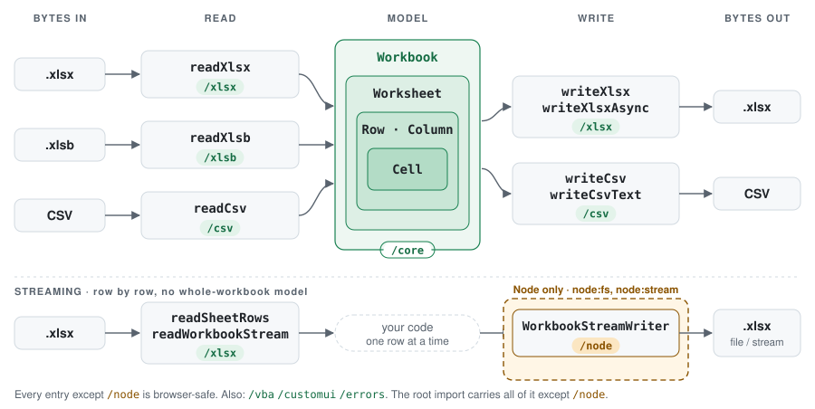

<div align="center">

<picture>
  <source media="(prefers-color-scheme: dark)" srcset="assets/banner-dark.svg">
  
</picture>

Read and write .xlsx from TypeScript, in Node and the browser.

[![npm][npm-badge]][npm]
[![CI][ci-badge]][ci]
[![downloads][downloads-badge]][npm]
[![license][license-badge]][license]

---

[Install](#install) • [Quickstart](#quickstart) • [Streaming](#streaming) • [Guide][site] • [API reference](docs/api/README.md)

---

</div>

<picture>
  <source media="(prefers-color-scheme: dark)" srcset="assets/demo-dark.svg">
  
</picture>

`ts-xlsx` turns a `Workbook` into `.xlsx` bytes and back.
`writeXlsx` returns a `Uint8Array`, `readXlsx` takes one, and both are synchronous function calls.
Nothing touches the filesystem unless you do, so the same code runs in Node and in a browser tab.

- Read and write `.xlsx`, read `.xlsb`, read and write CSV.
- Stream rows out with memory bounded by the rows not yet committed, and read rows without building the model.
- Styles, number formats, merges, frozen panes, tables, autofilters, data validation, conditional formatting, images, comments, protection and page setup.
- Charts, shapes, slicers and form controls you didn't author survive a load and save byte for byte.
- Strict types: `cell.value` is one [`CellValue`](docs/api/cell-values.md) union, and a missing axis is `undefined`, never a sentinel.
- Hostile files are bounded: inflation is capped by counting real output, and XML entities are never expanded.
- One runtime dependency, [`fflate`](https://github.com/101arrowz/fflate).

Try it without installing in the [browser playground](https://shbernal.github.io/ts-xlsx/playground).

## Why ts-xlsx?

ExcelJS still serves tens of millions of downloads a month, but has had no release since 4.4.0 in October 2023.
`ts-xlsx` started from its code and its open issue backlog, and every bug from that backlog it fixed is now a regression test.

|                     | ExcelJS 4.4                                    | ts-xlsx                                  |
| ------------------- | ---------------------------------------------- | ---------------------------------------- |
| Buffered I/O        | async, Node `Buffer`                           | sync, `Uint8Array`                       |
| Browser             | a separate prebuilt bundle                     | the same imports, nothing to configure   |
| Runtime deps        | 9 (archiver, jszip, unzipper, saxes, ...)      | 1 (`fflate`)                             |
| Types               | hand-written `.d.ts` beside JavaScript         | strict TypeScript source                 |
| Module format       | CommonJS                                       | ESM only                                 |

The API is not a drop-in replacement.
[Migrating from ExcelJS](docs/migrating-from-exceljs.md) maps the common patterns.

## Install

Needs Node 24 or later, or any modern browser bundler.

```shell
npm install @shbernal/ts-xlsx
```

## Quickstart

1. Build a workbook and write it to bytes.

   ```ts
   import {Workbook, writeXlsx} from '@shbernal/ts-xlsx';

   const wb = new Workbook();
   const sheet = wb.addWorksheet('People');
   sheet.addRow(['Name', 'Joined']);
   sheet.addRow(['Ada', new Date('2026-01-01')]);
   sheet.addRow(['Grace', new Date('2026-02-14')]);
   sheet.getCell('C1').value = {formula: 'COUNTA(A:A)', result: 3};

   const bytes: Uint8Array = writeXlsx(wb);
   ```

2. Save them however your platform saves bytes. In Node:

   ```ts
   import {writeFileSync} from 'node:fs';

   writeFileSync('people.xlsx', bytes);
   ```

3. Read a file back. A Node `Buffer` is a `Uint8Array`, so it goes straight in.

   ```ts
   import {readFileSync} from 'node:fs';
   import {readXlsx} from '@shbernal/ts-xlsx';

   const people = readXlsx(readFileSync('people.xlsx')).requireWorksheet('People');
   console.log(people.getCell('A2').value); // 'Ada'
   ```

The [guide][site] goes on from here: styles and number formats, tables and structure, errors, and the browser.

## Streaming

To make one pass over a large sheet without building the model, read it row by row.
The package is still inflated whole, so this roughly halves peak memory rather than bounding it:

```ts
import {readSheetRows} from '@shbernal/ts-xlsx';

for (const row of readSheetRows(bytes, {sheet: 'People'})) {
  console.log(row.number, row.cells.map((c) => c.value));
}
```

Or write one, sending each committed row to the file as you go:

```ts
import {WorkbookStreamWriter} from '@shbernal/ts-xlsx/node';

const writer = new WorkbookStreamWriter({filename: 'big.xlsx'});
const out = writer.addWorksheet('Big');
for (let i = 1; i <= 1_000_000; i++) await out.addRow([i, i * i]).commit();
await out.commit();
await writer.commit();
```

The streaming writer is the one Node-only part, so it lives on its own `/node` subpath.
For a large write that should not block a server, `writeXlsxAsync` keeps the buffered API and runs compression on worker threads.
The [streaming guide](docs/guide/streaming.md) covers what each mode keeps in memory and what it gives up.

## How it works

The model is four types.
A `Workbook` holds `Worksheet`s, a worksheet hands out `Row` and `Column` handles, and those reach `Cell`s.
The handles read and write straight through to the sheet, so asking about row 500 of an empty sheet creates nothing.

Readers build that model from bytes and writers turn it back into bytes, with a hand-written SAX parser on the way in and `fflate` for the zip.
Parts the model doesn't cover, like pivot caches and charts, ride along untouched.

<picture>
  <source media="(prefers-color-scheme: dark)" srcset="assets/diagram-dark.svg">
  
</picture>

Each format also has its own subpath (`/core`, `/xlsx`, `/xlsb`, `/csv`, `/errors`, ...) for when you want the module graph to say what you depend on.
[In the browser](docs/guide/browser.md) has the table of entries and what each one loads.

## Report a bug from your agent

The package ships a skill, `ts-xlsx-upstream`, that helps a coding agent turn a library bug into an issue with a minimal reproduction, without uploading your spreadsheet.

```shell
npx skills add ./node_modules/@shbernal/ts-xlsx
```

Or open an issue yourself at <https://github.com/shbernal/ts-xlsx/issues>.

## More

- [Guide and playground][site]
- [API reference](docs/api/README.md), generated from the public types
- [Migrating from ExcelJS](docs/migrating-from-exceljs.md)
- [Architecture](docs/architecture.md) and [decision records](docs/decisions/)
- [Changelog](CHANGELOG.md)

## Lineage

`ts-xlsx` forked [ExcelJS](https://github.com/exceljs/exceljs) in July 2026, keeping its git history back to 2014, and has since been rewritten in strict TypeScript.
It keeps ExcelJS's MIT license.
[`AGENTS.md`](AGENTS.md) sets out the rules every change follows.

[site]: https://shbernal.github.io/ts-xlsx/
[npm]: https://www.npmjs.com/package/@shbernal/ts-xlsx
[npm-badge]: https://img.shields.io/npm/v/%40shbernal%2Fts-xlsx?style=for-the-badge&logo=npm&logoColor=white&color=146c43
[ci]: https://github.com/shbernal/ts-xlsx/actions/workflows/build.yml
[ci-badge]: https://img.shields.io/github/actions/workflow/status/shbernal/ts-xlsx/build.yml?branch=main&style=for-the-badge&logo=githubactions&logoColor=white&label=CI&color=146c43
[downloads-badge]: https://img.shields.io/npm/dw/%40shbernal%2Fts-xlsx?style=for-the-badge&color=178050
[license]: LICENSE
[license-badge]: https://img.shields.io/github/license/shbernal/ts-xlsx?style=for-the-badge&color=125c39
